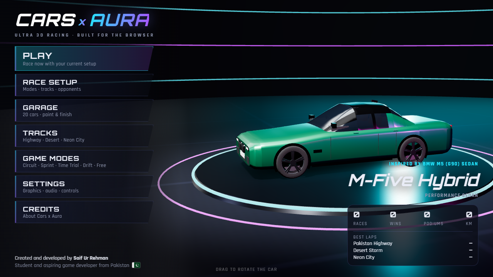
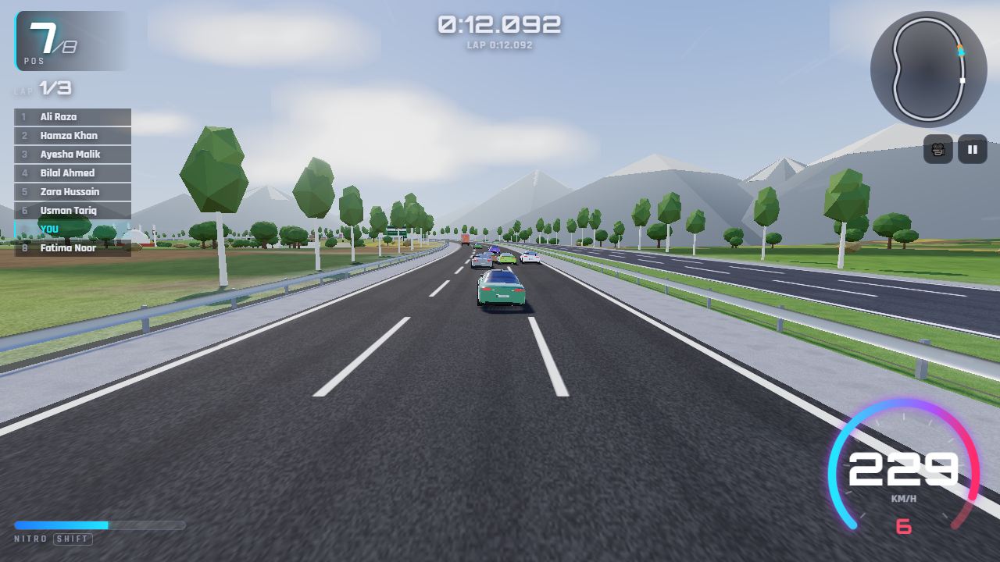
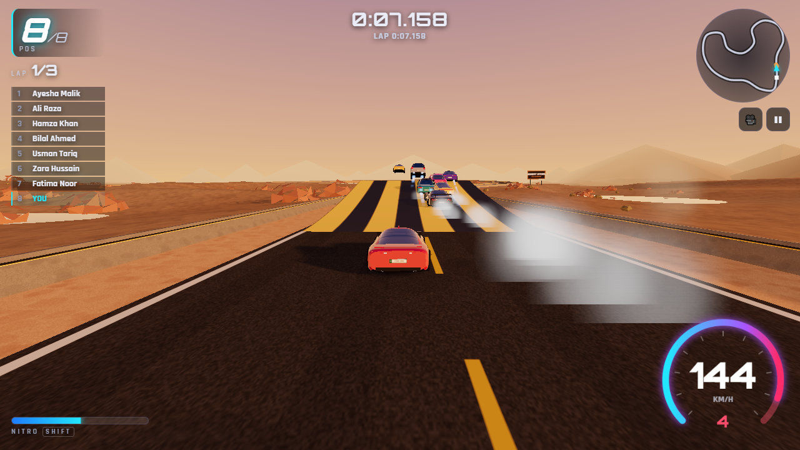
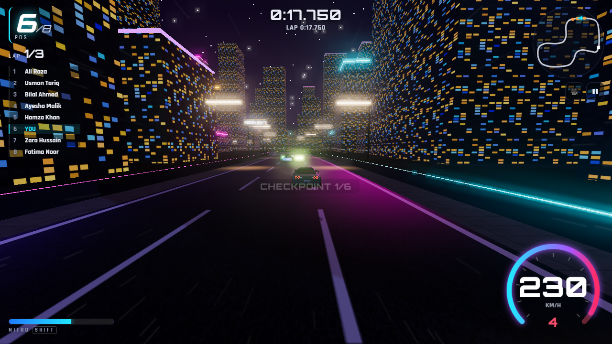
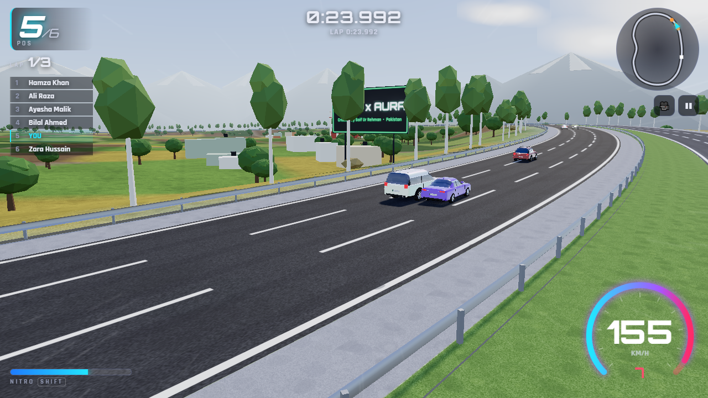
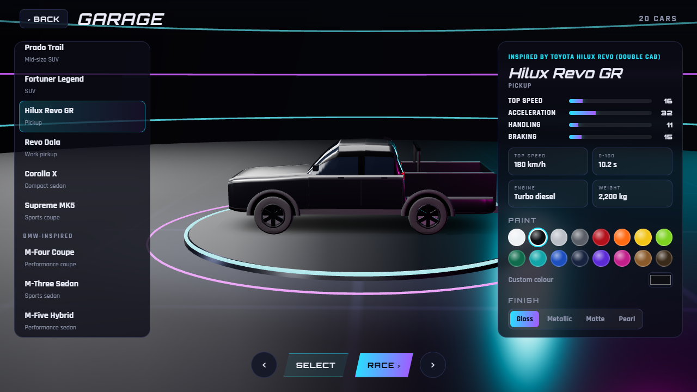
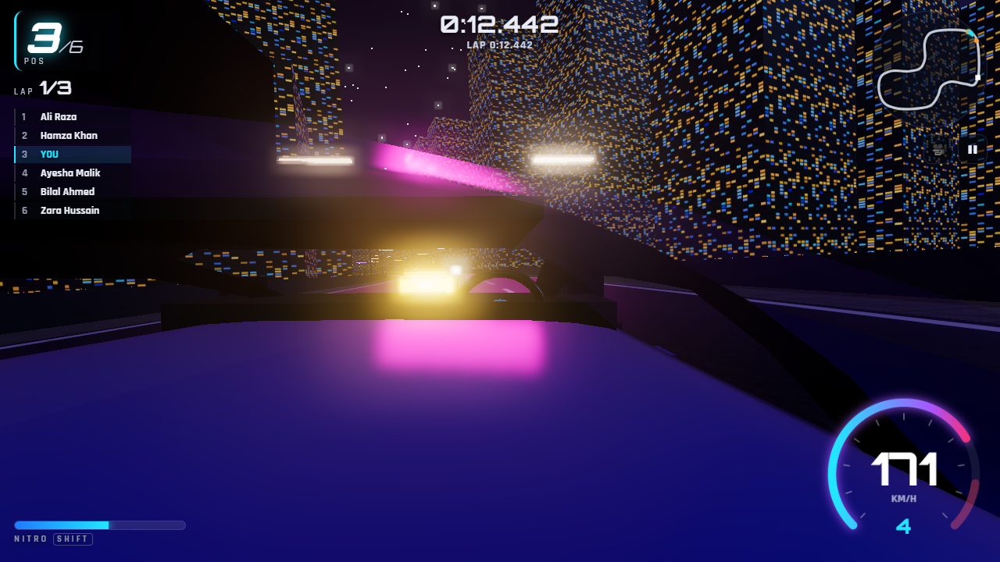

# Cars x Aura — Ultra-3D Racing for the Web


> **Cars x Aura**
>
> Created and developed by **Saif Ur Rehman**
> Student and aspiring game developer from Pakistan 🇵🇰
>
> Passionate about game development, 3D graphics, animation, and interactive web experiences.

Cars x Aura is a free, browser-based 3D arcade racing game inspired by the energy of Asphalt 8: Airborne. It has its own identity, tracks, interface and assets. It runs entirely in the browser with Three.js (WebGL) and the Web Audio API, and is hosted through a small Streamlit wrapper. No accounts, API keys or paid services are needed.



| Pakistan Highway | Desert Storm |
|---|---|
|  |  |
| **Neon City** | **Cinematic camera** |
|  |  |
| **Garage** | **Cockpit view** |
|  |  |

---

## Built with: languages and technologies

The game is written in **JavaScript**, which runs in the browser. **Python** is used only to host it with Streamlit and to run the automated tests.

| Language | Share of the project's own code | Used for |
|---|---|---|
| **JavaScript** (ES modules) | 85.9 % | the whole game: 3D rendering, physics, AI, race logic, cars, tracks, audio and UI |
| **CSS** | 7.8 % | menus, garage, HUD, touch controls and responsive layout |
| **Python** | 4.9 % | Streamlit hosting (`app.py`, `streamlit_app/`) and the Playwright test suite (`tests/`) |
| **HTML** | 1.3 % | the single game page (`frontend/index.html`) |
| **Batch** | 0.1 % | Windows launchers (`PLAY_GAME.bat`, `RUN_STREAMLIT.bat`) |

| Technology | Role |
|---|---|
| [Three.js](https://threejs.org) r160 / **WebGL 2** | 3D engine: rendering, shadows, materials, bloom post-processing |
| **Web Audio API** | all sound, synthesised live: engines, tyres, effects, music |
| **Canvas 2D** | procedural textures, the speedometer and the mini-map |
| **localStorage** | saves, settings and ghost laps |
| [Streamlit](https://streamlit.io) | free hosting wrapper (Streamlit Community Cloud) |
| [Playwright](https://playwright.dev) | automated browser tests |

The percentages exclude the bundled Three.js library in `frontend/lib/`, which `.gitattributes` marks as vendored so GitHub's language bar counts only the game's own code.

---

## Features

- **20 drivable cars** in the Toyota-, BMW-, Honda-, Nissan-, Porsche- and Mercedes-inspired body styles, plus an original hypercar, the **AURA X**. Every car has its own top speed, acceleration, grip, braking, mass, gearbox and engine sound.
- **3 complete tracks**:
  - **Pakistan Highway**: a divided motorway through farmland, with bilingual green signs, a river with two bridges, an overpass, a mosque, a village and optional truck-art traffic.
  - **Desert Storm**: a sunset rally stage with two jumps, a canyon viaduct, an oasis and a sandstone fort.
  - **Neon City**: a night street circuit with neon barriers, street lights, a tunnel and an illuminated harbour bridge.
- **5 game modes**: Circuit Race (AI rivals), Sprint, Time Trial (with a saved ghost car), Drift Challenge and Free Drive.
- **Arcade physics** on a fixed 120 Hz timestep, so handling is the same at any frame rate:
  - speed-sensitive steering, grip and inertia
  - handbrake drifts with counter-steer assist
  - automatic gearbox, nitro, body roll, suspension bounce, jumps and landings
  - wall and car-to-car collisions, and a reset/recovery key
  - three handling presets: Arcade (default), Sport and Professional
- **AI opponents** that follow a racing line, brake for corners, avoid each other, use nitro on straights, recover when stuck, and come in three skill levels.
- **Six cameras**: chase, close chase, front, hood, cockpit (with a working steering wheel) and cinematic trackside. The chase cameras widen their field of view with speed, shake on impacts and can be orbited with the mouse.
- **Effects**:
  - tyre smoke, skid marks, desert dust, sparks, nitro flames and backfires
  - speed lines, plus bloom and radial blur on High/Ultra
  - night headlight beams, shadows and image-based reflections
- **Garage** with 16 paint colours plus a custom colour, and Gloss, Metallic, Matte and Pearl finishes.
- **HUD**: speedometer, tachometer, gear, position, lap, timers, mini-map, live standings, checkpoints with split times, drift chain counter and a wrong-way warning.
- **Fully synthesised audio**: an RPM-driven engine sound for each engine type (V8, twin-turbo V6, inline-6, turbo-4, diesel, flat-6, hybrid V12), plus turbo whistle, blow-off, tyre squeal, wind, ambience, impacts, race cues and a procedural synthwave soundtrack.
- **Desktop and mobile controls**: keyboard, gamepad and on-screen touch controls. Held controls are released automatically when the window loses focus.
- **Graphics presets** (Low, Medium, High, Ultra, plus Auto-detect) and adaptive resolution.
- **Local progress**: settings, paint jobs, best laps, records and ghosts are saved in the browser.

> **About the cars.** Every vehicle is an *original procedural model* generated in code (`frontend/vehicles/VehicleFactory.js`) from the proportions of the real body style it is inspired by. The models are stylised and clean, but they are **not photorealistic replicas** and use **no manufacturer logos**. The reference photos were used only to study proportions and design cues.

---

## Run it locally on Windows

You need **Python 3.9 or newer** and an up-to-date Chrome, Edge or Firefox. Open **PowerShell** in the project folder:

```powershell
cd "C:\Users\LENOVO\OneDrive\Desktop\New folder\cars-x-aura"
python -m pip install -r requirements.txt
python -m streamlit run app.py --server.port 8796
```

Then open **http://localhost:8796**. You can also double-click **`RUN_STREAMLIT.bat`**.

To play **without Streamlit** (a plain local web server, which also works offline), double-click **`PLAY_GAME.bat`**, or run:

```powershell
cd "C:\Users\LENOVO\OneDrive\Desktop\New folder\cars-x-aura\frontend"
python -m http.server 8797
```

Then open **http://localhost:8797**.

> On machines with several Python installations, use the one that has Streamlit installed. `python` is tried first and `py` is the fallback. Opening `index.html` directly from disk (`file://`) does **not** work, because browsers block ES modules there.

---

## Controls

| Action | Keyboard | Gamepad | Touch |
|---|---|---|---|
| Accelerate | W / ↑ | RT / A | GAS |
| Brake / reverse | S / ↓ | LT / X | BRAKE |
| Steer | A D / ← → | Left stick / D-pad | ◀ ▶ |
| Handbrake / drift | Space | B | DRIFT |
| Nitro | Shift | LB / RB | N2O |
| Change camera | C | Y | 🎥 |
| Reset car | R | Back | ↺ |
| Pause | Esc / P | Start | ❚❚ |
| Mute | M | — | — |

**Tips**

- **Drift:** tap Space while steering, then steer to hold the slide. Drifting and airtime refill your nitro.
- **Perfect start:** during the countdown, hold the revs mid-range on the tachometer (not on the red line) as GO appears.
- **Orbit the camera:** drag with the mouse in the chase views.
- **Streamlit:** click the game once so it receives keyboard input, and use the ⛶ button for a full-screen tab.

---

## Cars

| Inspired by | In-game name | Class | Top speed | 0–100 |
|---|---|---|---|---|
| Toyota Land Cruiser 300 | Cruiser 300 | Full-size SUV | 210 | 6.7 s |
| Toyota Land Cruiser Prado | Prado Trail | SUV | 180 | 9.4 s |
| Toyota Fortuner Legender | Fortuner Legend | SUV | 185 | 9.8 s |
| Toyota Hilux Revo (double cab) | Hilux Revo GR | Pickup | 180 | 10.2 s |
| Toyota Hilux single cab ("Dala") | Revo Dala | Work pickup | 160 | 13.0 s |
| Toyota Corolla | Corolla X | Compact sedan | 195 | 9.6 s |
| Toyota GR Supra | Supreme MK5 | Sports coupe | 255 | 4.1 s |
| BMW M4 | M-Four Coupe | Performance coupe | 290 | 3.6 s |
| BMW M3 | M-Three Sedan | Sports sedan | 285 | 3.7 s |
| BMW M5 (G90) | M-Five Hybrid | Performance sedan | 305 | 3.5 s |
| BMW X5 | X-Five M Sport | Luxury SUV | 250 | 4.4 s |
| Honda Civic (11th gen) | Civic Eleven | Sport sedan | 210 | 7.9 s |
| Honda Civic Type R | Type-R Evo | Hot hatch | 275 | 5.4 s |
| Honda Accord | Accord Prime | Executive sedan | 220 | 7.1 s |
| Honda CR-V | CR-Vista | Compact SUV | 200 | 8.6 s |
| Honda City | City Spark | Compact sedan | 185 | 10.6 s |
| Nissan GT-R | Godzilla R | Supercar | 315 | 2.9 s |
| Porsche 911-style | Nine-Eleven S | Sports car | 310 | 3.0 s |
| Mercedes-Benz C-Class (AMG Line) | Stern C-Line | Luxury sedan | 250 | 4.7 s |
| — original — | **AURA X** | Hypercar | 380 | 2.3 s |

The cars are right-hand drive, as in Pakistan. SUVs and pickups lose less speed off the road than sports cars do.

---

## Graphics settings

| Preset | Shadows | Bloom | Particles | Scenery | Intended for |
|---|---|---|---|---|---|
| Low | blob only | — | 160 | 45 % | phones, integrated GPUs |
| Medium | 1024² | — | 380 | 75 % | laptops (e.g. Intel UHD 620) |
| High | 2048² soft | ✓ | 800 | 100 % | dedicated GPUs |
| Ultra | 4096² soft | ✓ + radial blur | 1400 | 130 % | powerful desktops |

**Auto** picks a preset from the GPU name. **Adaptive resolution** lowers the render scale when the frame rate drops below about 48 FPS and raises it again when there is headroom. The target is 60 FPS on capable hardware; weaker devices will run lower.

---

## Project structure

```
cars-x-aura/
├── app.py                      Streamlit entry point
├── requirements.txt            streamlit (only dependency)
├── streamlit_app/game_component.py   serves frontend/ as a Streamlit component
├── .streamlit/config.toml      theme (no port — Cloud needs 8501)
├── RUN_STREAMLIT.bat / PLAY_GAME.bat  Windows launchers
├── netlify.toml                optional static hosting
├── frontend/                   THE GAME (static, no build step)
│   ├── index.html  styles.css  main.js
│   ├── game/      Game, GameLoop, InputManager, VehiclePhysics, CollisionManager, RaceManager,
│   │              AIController, CameraManager, AudioManager, SaveManager, Environment, Effects,
│   │              Traffic, Quality, textures, utils
│   ├── vehicles/  VehicleConfig (data), VehicleFactory (procedural models), Vehicle, geometry
│   ├── tracks/    TrackManager, TrackBuilder, PakistanHighway, DesertStorm, NeonCity, scenery
│   ├── ui/        MainMenu, Garage, RaceSetup, HUD, Settings, Overlays, TouchControls, Showroom, dom
│   ├── assets/fonts/   Orbitron + Rajdhani (OFL)
│   └── lib/       Three.js r160 + es-module-shims (vendored, MIT)
├── tests/         run_tests.py (automated browser tests) + test reports (.md)
└── docs/screenshots/
```

The project has no `models/`, `textures/` or `audio/` asset folders. Every model, texture (drawn on a `<canvas>`) and sound (Web Audio synthesis) is generated at runtime, which keeps the download at about **1.7 MB** and avoids any licensing questions.

---

## How it works

- **Game loop:** physics runs in fixed 1/120 s steps, and rendering runs at the display rate. Long frames are clamped, so the car never teleports after a tab switch.
- **Tracks:** each track is a closed Catmull-Rom spline sampled every ~2 m into position, tangent, curvature and elevation. A spatial hash projects any point onto the track in O(1). That one query gives:
  - the ground height (ramps included) and the surface type
  - the lateral offset used for the walls
  - the progress used for lap counting and positions

  The road, shoulders, walls, kerbs, tunnels, ramps and bridge pillars are swept along the spline. The terrain heightfield blends into the road corridor, except over rivers and canyons, which get viaducts.
- **Car physics:** a bicycle-model arcade car. The engine force curve is derived from each car's 0–100 time and top speed, and the cornering limit from its grip. Tyre grip bleeds off lateral velocity (lower grip means a drift), and part of the scrubbed energy is kept as forward speed so drifts stay fast. Vertical motion follows the ground until the ground falls away faster than gravity, which is how cars fly off ramps and crests.
- **Collisions:** walls are lateral limits in track space, with wall guidance so the car slides along the barrier instead of sticking. Cars collide as two circles each, resolved with mass-weighted impulses. Traffic vehicles are heavy bodies.
- **AI:** each AI car looks ahead along its own racing line (inside of upcoming corners) and plans braking from the curvature within its braking distance. It overtakes on the side with more room, holds back when boxed in, uses nitro on straights and resets itself if stuck. Mild rubber-banding keeps races close.
- **Streamlit:** `components.declare_component(path="frontend")` makes the Streamlit server itself serve the game files, with correct MIME types, at `/component/…`. A small bridge in `index.html` reports readiness and sizes the iframe to the browser window. Python never renders frames, so Streamlit reruns cannot stutter the game.

---

## Deploy for free on Streamlit Community Cloud

1. **Create a GitHub repository.**
   - With **GitHub Desktop**: *File → Add local repository →* select the `cars-x-aura` folder, *create a repository* if asked, *Publish repository*. Untick *Keep this code private* if you want it public.
   - Or with git on the command line:
     ```powershell
     cd "C:\Users\LENOVO\OneDrive\Desktop\New folder\cars-x-aura"
     git init
     git add .
     git commit -m "Cars x Aura v1.0"
     git branch -M main
     git remote add origin https://github.com/<your-username>/cars-x-aura.git
     git push -u origin main
     ```
   - Make sure the `frontend/` folder (including `frontend/lib/`) is pushed. The game cannot load without it.
2. Go to **https://share.streamlit.io** and sign in with GitHub.
3. Click **Create app → Deploy a public app from GitHub**.
4. Choose your repository, branch `main`, and main file **`app.py`**. You can pick a custom subdomain, such as `cars-x-aura`.
5. Click **Deploy**. The first build installs Streamlit (about 1–2 minutes). You don't need secrets, API keys or extra settings.
6. Open the URL you get (for example `https://cars-x-aura.streamlit.app`) and click **PLAY**.

To update the game, commit and push. Streamlit Cloud redeploys automatically.

> Do not put `server.port` in `.streamlit/config.toml`. Streamlit Cloud's health check expects port 8501. Use `--server.port 8796` only on the command line, locally.

### Static hosting alternative (also free)

The game itself needs no server code, so `frontend/` can be hosted as a static site:

- **Netlify:** use *Add new site → Import from Git* and pick the repo. `netlify.toml` already sets `publish = "frontend"`. You can also drag the `frontend` folder onto https://app.netlify.com/drop.
- **Cloudflare Pages / Vercel:** use no build command, with the output directory set to `frontend`.
- **GitHub Pages:** copy the contents of `frontend/` into a `docs/` folder or a `gh-pages` branch, then enable Pages.

---

## Troubleshooting

| Problem | Fix |
|---|---|
| Stuck on "Loading…" / *"run the game through a web server"* | You opened `index.html` from disk. Use `PLAY_GAME.bat` or Streamlit. |
| *"3D graphics (WebGL) are switched off"* | Enable **hardware acceleration** in browser settings (Chrome: Settings → System), update your graphics driver, and restart the browser. Check https://get.webgl.org. |
| Blank game area on Streamlit Cloud / 404s in the console | `frontend/` (or `frontend/lib/`) was not committed. Push it, then reboot the app from the Streamlit menu. Paths are case-sensitive on Linux servers. |
| Keyboard does nothing in Streamlit | Click inside the game once: the game lives in an iframe and needs focus. |
| Fullscreen doesn't work inside the page | Use the **⛶** button (top-right) to open the game in its own tab, then use Settings → Toggle fullscreen or F11. |
| No sound | Browsers start audio only after a click or key press. Also check Settings → Audio and that **M** (mute) isn't on. |
| Low FPS | Choose **Low** or **Medium** in Settings → Graphics, keep adaptive resolution on, close other GPU-heavy tabs and plug in your laptop. |
| Progress lost | Saves live in this browser's local storage. Private windows and clearing site data erase them, and they don't sync between browsers or devices. |
| Very old Safari / Firefox | Import maps are polyfilled by `es-module-shims`. Browsers without ES-module or WebGL support show a clear message instead of a blank page. |

---

## Testing

`tests/run_tests.py` drives the real game in Chrome through Playwright. It covers:

- menus and the garage
- saving and reloading
- acceleration, braking, reverse, gearbox, wheels, walls, drift and nitro
- every game mode
- an 8-car AI lap on Desert Storm at 4× speed
- jumps
- all four quality presets
- touch controls
- GPU-memory release between races
- the Streamlit embed

```powershell
python -m pip install playwright
python tests/run_tests.py --channel chrome
python tests/run_tests.py --channel chrome --streamlit http://localhost:8796   # with Streamlit running
```

The latest run passed **42 of 42 checks**. Details are in [`tests/gameplay-tests.md`](tests/gameplay-tests.md), [`tests/vehicle-physics-tests.md`](tests/vehicle-physics-tests.md) and [`tests/deployment-tests.md`](tests/deployment-tests.md).

---

## Known limitations

- The cars are stylised procedural models, not photoreal scans, and they have no manufacturer logos.
- There is no damage model, and cars don't flip or roll over (arcade design).
- AI is waypoint-based. It races well but doesn't block or draft strategically.
- Highway traffic exists only on Pakistan Highway.
- There is no online multiplayer. The code is modular for it, but no networking is implemented.
- Progress is stored per browser (localStorage) and doesn't sync between devices.
- Real reflections are image-based (environment maps). There are no screen-space reflections on the wet road.
- Performance depends on the GPU. Integrated graphics run best on Low or Medium.

## Roadmap

1. Ghost sharing, and a tournament / career mode with unlockable cars and tracks.
2. More tracks: a Karachi coastal road, a northern mountain pass (Karakoram-style), and a rain variant of Neon City.
3. Optional glTF car models (Draco-compressed) when properly licensed models are available.
4. Visual damage, a replay system and a photo mode.
5. Online multiplayer (WebRTC P2P lobby), once a real networking layer is built and tested.
6. Gamepad remapping and force feedback where the browser supports it.

---

## Licences and credits

See [`LICENSES.md`](LICENSES.md). Three.js and es-module-shims are MIT-licensed. Orbitron and Rajdhani are under the SIL Open Font License. All game code, procedural models, textures and audio are original work for Cars x Aura.

Cars x Aura is an independent, non-commercial project. It is **not affiliated with, endorsed or sponsored by** Toyota, BMW, Honda, Nissan, Porsche, Mercedes-Benz, Gameloft or any other company. Brand and model names are used only to describe which real-world body style inspired each original model, and all trademarks belong to their owners.
